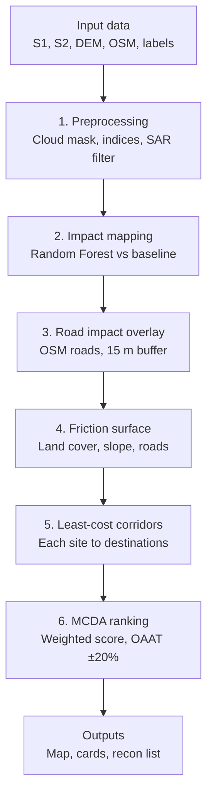

# Project Shore-Gate: Egress

Satellite and machine-learning decision support for post-disaster maritime-to-inland logistics.

**Course:** GEOG761 | **Client:** RNZN / GNZ Maritime
**Case study:** 2022 Hunga Tonga–Hunga Haʻapai eruption, Tongatapu

---

## What this does

Screens pre-nominated coastal access sites after a disaster and ranks them by whether
supplies can plausibly move *inland* from them. Outputs a ranked shortlist, per-site
access cards, and a reconnaissance priority list flagging where confidence is lowest.

**Scope boundary:** this does not assess the seaward approach (water depth, obstructions).
It assesses egress — whether cargo can leave the beach. Every site still requires field
verification.

---

## Pipeline

| Stage | Input | Output |
|---|---|---|
| 1. Impact mapping | Sentinel-1 SAR, Sentinel-2 optical (pre/post) | Random Forest classification: water/inundated, sand, bare ground, vegetation, infrastructure |
| 2. Friction surface | Land cover + Copernicus DEM slope + OSM road-impact overlay | Per-pixel relative movement cost |
| 3. Corridor modelling | Friction surface + site/destination points | Least-cost paths, coastal site → inland destination |
| 4. Site ranking | Corridor cost, hazard, connectivity, confidence | MCDA score + OAAT sensitivity results |

---

---

## Repo structure

```
data/           # gitignored — see "Data" below
notebooks/      # exploratory work, one owner each
src/            # shared functions (importable, reviewable)
params/         # parameter decisions — SINGLE SOURCE OF TRUTH
outputs/        # maps, figures, access cards
docs/           # proposal, write-up, partner correspondence
```

---

## Data

**Nothing in `data/` is committed.** A single Sentinel-2 tile is ~700MB; GitHub's
file cap is 100MB, and large files are painful to remove from history once added.

To reconstruct the dataset, see `data/README.md` for the exact scene IDs, dates and
download sources. Add any new scene you use to that file.

### Sources

| Dataset | Use | Access |
|---|---|---|
| Sentinel-1 GRD (IW, VV+VH) | Impact mapping through cloud/ash | Copernicus / GEE |
| Sentinel-2 L2A | Impact mapping, spectral indices | Copernicus / GEE |
| Copernicus DEM (GLO-30) | Slope for friction surface | Copernicus / GEE |
| OpenStreetMap | Road network baseline | Geofabrik / HOT |
| UNOSAT + Copernicus EMS | Reference labels for training/validation | UNOSAT, Copernicus EMS activations |

---

## Setup

```bash
git clone <repo-url>
cd shore-gate-egress
python -m venv .venv && source .venv/bin/activate   # Windows: .venv\Scripts\activate
pip install -r requirements.txt
```

---

## Working agreements

- **Parameters live in `params/parameters.md`.** If you change a threshold, weight or
  friction value, change it there and say why. Do not hardcode it in a notebook.
- **Notebooks have one owner each.** They diff badly; two people editing the same
  notebook produces unresolvable conflicts. Shared logic goes in `src/`.
- **Branch per feature**, PR into `main`. No direct pushes to `main`.
- **Commit messages:** what changed and why, not "update".

---

## Team

Danny Jung · Fuad Fachrudin · Mohd Allif Najmi bin Musa · Syeda Samana Raza · Shiyin Lin

## Running the Earth Engine scripts

All Earth Engine assets used by the scripts in `src/gee/` are shared as
**"Anyone can read"** under `projects/shore-gate-egress/assets/`, so any
Earth Engine account can run them without copying data.

- `dpm_0122_score`: ALOS-2 Damage Proxy Map (ARIA/JAXA, 22 Jan 2022), uploaded
- `emsr558_*`: Copernicus EMS EMSR558 grading (roads, buildings, footprints, ash), uploaded
- `tongatapu_destinations_20220115_gee`: inland destinations (see `outputs/destinations/`)
- `dpm_labels_v1_c3`, `features_v1`, `impact_samples_v1`, `impact_score_v1`,
  `friction_v1`: frozen outputs of scripts 08, 09b, 10 and 13

**To reproduce the results:** open a script in the Code Editor
(code.earthengine.google.com) and press **Run**. Scripts read the frozen assets,
so each can run on its own; for example, `10_impact_rf.js` prints the
cross-validation confusion matrices, metrics and feature importance to the Console.
Export blocks write to our project and are not needed for checking results.

**Script order:** 08 labels → 09a/09b features → 10 impact RF →
11 EMSR558 validation → 13 friction surface → 14 routing stack export →
`notebooks/15_routing_mcda_v2.ipynb` → `app/`.
